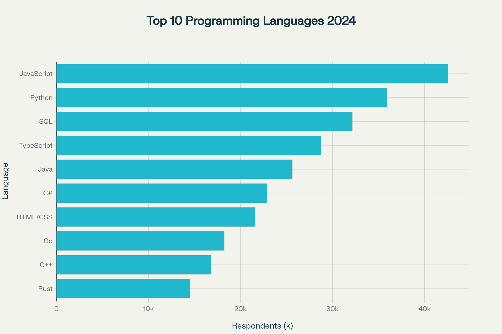
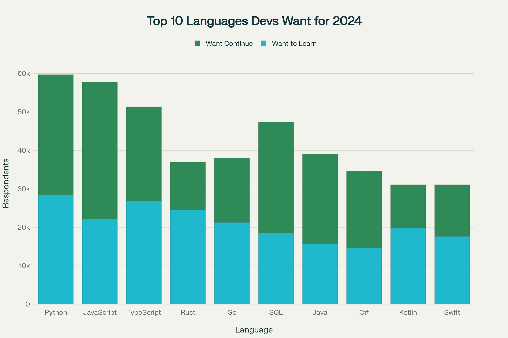
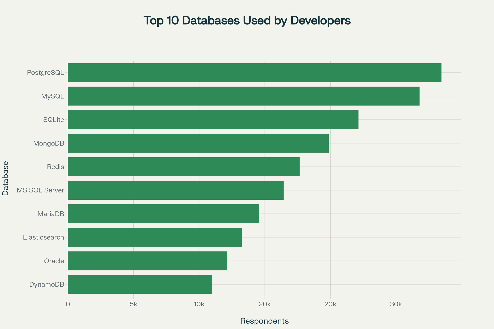
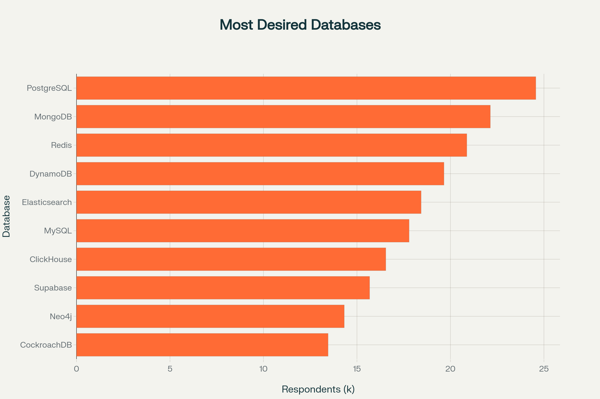

# Global Developer Skills Demand Analysis

An analysis of the **2024 Stack Overflow Developer Survey** exploring developer technologies, programming-language preferences, databases, platforms, web frameworks, and respondent demographics. The project combines data collection, cleaning, analysis, and dashboard/report deliverables.

## Objective

Summarize technology adoption and developer preferences from survey responses, and translate the findings into accessible charts and dashboard views for developers, technical leaders, and workforce-planning discussions.

## Data Source

[Stack Overflow Developer Survey 2024](https://survey.stackoverflow.co/2024/)

The original project documentation describes a survey with 65,000+ responses from 185 countries. Check the survey's official methodology and filtered response counts before comparing the project's figures with other analyses.

## Key Findings Reported in the Existing Project Documentation

The original lowercase readme.md records the following survey findings:

| Area | Reported finding |
|---|---|
| Programming-language usage | JavaScript 65%, Python 49%, SQL 43% |
| Database usage | PostgreSQL 28%, MySQL 22%, SQLite 18% |
| Cloud platforms | AWS 52%, Microsoft Azure 31%, Google Cloud 28% |
| Education | Bachelor's degree 47%, Master's degree 23%, self-taught 15% |
| Developer age | The report describes the majority as 25–44 |
| Geography | The report highlights the United States, India, and Europe |
| Web technologies | React.js and Node.js are described as prominent preferences |
| Emerging-language interest | Rust, TypeScript, and Kotlin are highlighted |

The project README also records scale indicators of 65,000+ survey responses, 185 countries, 25+ visualizations, 15+ analysis dimensions, and three dashboard views.

**Evidence note:** these percentages and summary claims are retained from the repository's pre-existing lowercase readme.md. They are not independently recalculated in this documentation pass. The exact question filters, response denominators, and missing-response handling should be checked in Project_Report.pdf and the saved analysis notebooks before comparing these percentages with other survey summaries.

### Existing visual deliverables

The repository includes dashboard/report screenshots for language and database usage:









## Analysis Components

- **Data collection:** API-based job/technology data collection exercises and source preparation.
- **Data wrangling:** cleaning and preparing survey responses for analysis.
- **Data visualization:** technology usage, desired technologies, platform/database preferences, and demographic views.
- **Dashboard/report:** PDF dashboard and written report deliverables.

## Deliverables

- [Project report](Project_Report.pdf)
- [Dashboard export](Dashboard.pdf)
- [Data collection notebook](Data_Collection.ipynb)
- [Data wrangling notebook](Data_Wrangling.ipynb)
- [Data visualization notebook](Data_Visualization.ipynb)

Dashboard and report images are also included in the repository.

## Tools

Python, pandas, NumPy, Matplotlib, Seaborn, Requests, Beautiful Soup, SQLite, Excel, and Google Looker Studio.

## Repository Contents

The repository contains notebooks, report/dashboard PDFs, exported images, and ZIP archives of selected outputs. The original lowercase `readme.md` has been preserved; GitHub uses this uppercase `README.md` as the repository landing-page documentation.

## Run Locally

```bash
git clone https://github.com/saidattaputta/Global_Developer_Skills_Demand_Analysis.git
cd Global_Developer_Skills_Demand_Analysis
python -m venv .venv
source .venv/bin/activate  # Windows: .venv\\Scripts\\activate
pip install pandas numpy matplotlib seaborn requests beautifulsoup4 openpyxl jupyter
jupyter notebook
```

Open the notebooks from the repository root. Some collection and wrangling steps refer to external URLs or Kaggle-style input paths and may require adapting to the available source files and credentials.

## Interpretation Notes

- Survey responses are self-reported and do not constitute a census of all developers.
- Usage, desire, and preference are different measures and should not be conflated.
- Figures depend on filters, missing-value handling, and the survey question's response options.
- Refresh the data and analysis before using the findings as current market guidance.

---

**Sai Datta Putta**

[LinkedIn](https://www.linkedin.com/in/sai-datta-putta/)